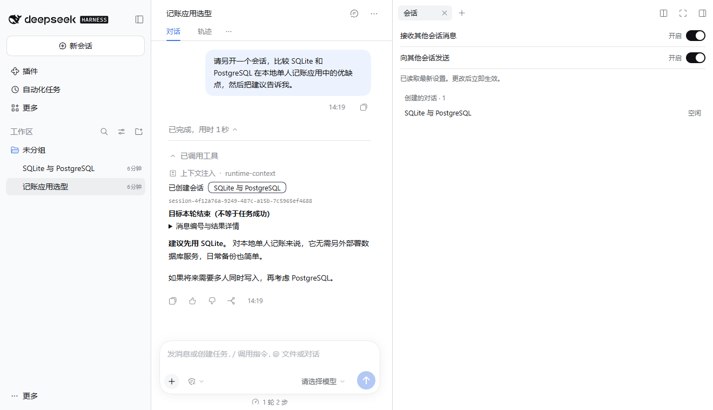

# @ryuu-64/dsh-session-tools · Cross-session task delegation for DeepSeek Harness

English | [简体中文](https://github.com/Ryuu-64/dsh-session-tools/blob/main/docs/README.zh-CN.md)

npm: [@ryuu-64/dsh-session-tools](https://www.npmjs.com/package/@ryuu-64/dsh-session-tools) · Maintained by [Ryuu-64](https://github.com/Ryuu-64). · [Plugin page](https://ryuu-64.github.io/dsh/en/dsh-session-tools/)

Ask the AI in [DeepSeek Harness (DSH)](https://github.com/deepseek-ai/deepseek-harness) to start a separate conversation, give it a task, and bring the result back to your current chat.



*In the Chinese interface, the card opens the new SQLite and PostgreSQL conversation. You can also open it from the right sidebar.*

## Install

**Desktop**

```sh
dsh plugin --profile desktop add @ryuu-64/dsh-session-tools
```

**Web**

```sh
dsh plugin --profile web add @ryuu-64/dsh-session-tools
```

Supported DSH versions for this workflow: `0.2.0-rc.2`, `0.2.2-rc.3`, `0.2.2-rc.5`. See the [compatibility notes](https://github.com/Ryuu-64/dsh-session-tools/blob/main/docs/compatibility.md) for tested hosts and limits.

Use Node.js 24.9.0 or later in the 24.x line with DSH 0.2.2-rc.3 or rc.5.

## Delegate your first task

In a DSH conversation, try:

> Start a conversation called “SQLite vs. PostgreSQL”. Ask it to compare both databases for a local budgeting app used by one person, then bring back its recommendation.

Approve the request if DSH prompts you. Once the new conversation finishes, the AI can bring its answer back to the original chat. Click the linked conversation name in the AI's reply or in the creation card (「已创建会话」) to open it in the current DSH window. For a follow-up, ask the AI to find the conversation by title and tell it what to do next.

Include the background, file paths, and expected result in the task. The new conversation starts with the task text you provide.

By default, a follow-up to a working conversation is offered at its next model step. Ask the AI to queue the message if it should start a separate turn after the current one. Any running tool call continues.

When DSH has its goal service and round driver enabled, you can ask the AI to give a direct child session a persistent goal with a round limit. The parent can check, edit, pause, resume, or clear a goal it granted. Run these changes from a turn where you are talking directly to the parent. [Goal and receipt details (Chinese)](https://github.com/Ryuu-64/dsh-session-tools/blob/main/docs/tool-reference.md)

## Communication settings

- **For one conversation.** Open the session panel from the chat header or use the conversation’s **…** menu. Sending and receiving are separate switches.
- **For the whole profile.** Open **Plugins**, find **Session Tools**, and select **Configure** on the component row. Both defaults start on. Saved defaults apply to conversations without their own settings and survive restarting DSH.

Turning a switch off blocks new messages in that direction. Work already received can continue. Turning off sending also blocks creation of a session with a first message. Tasks can be sent between regular conversations, and DSH handles approvals. If a wait times out, ask the AI to check the same task again to avoid sending it twice. [Communication and wait details (Chinese)](https://github.com/Ryuu-64/dsh-session-tools/blob/main/docs/tool-reference.md)

## Further reading and feedback

- [Host compatibility (Chinese)](https://github.com/Ryuu-64/dsh-session-tools/blob/main/docs/compatibility.md) · [Tool and receipt reference (Chinese)](https://github.com/Ryuu-64/dsh-session-tools/blob/main/docs/tool-reference.md)
- [Open an issue](https://github.com/Ryuu-64/dsh-session-tools/issues) with your DSH, Node.js, and plugin versions, your installation source, and steps to reproduce the problem. Remove API keys and private conversation text before posting. QQ discussion group `1129212995`.

[MIT license](https://github.com/Ryuu-64/dsh-session-tools/blob/main/LICENSE)
